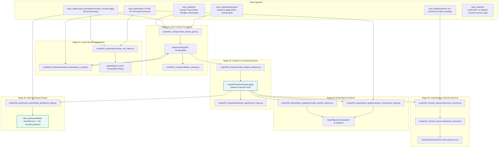

# Northern Virginia Urban Heat Island Analysis Pipeline Architecture

This document provides a comprehensive technical overview of the scientific analysis pipeline used in the Northern Virginia (NOVA) Urban Heat Island (UHI) mapping campaign.

---

## 1. System Overview & Data Flow

The pipeline ingests raw field measurements, continuous machine-learning modeled temperature surfaces, and jurisdictional tree canopy shapefiles, converting them into an analytical 100m grid (`hotspots.gpkg`), presentation-grade cartographic figures, and lightweight binary assets for the web dashboard.



---

## 2. Pipeline Execution Stages

### Stage 1: High-Performance Tree Canopy Aggregation (`scripts/01_canopy/`)
- **`make_canopy_grid.py`**:
  - Uses streaming C++ rasterization (`gdal_rasterize`) to project and burn 3.5+ million jurisdictional tree canopy polygon geometries (Fairfax 2021, Arlington 2023, Alexandria 2013) into a unified 1m raster mask.
  - Computes exact tree canopy area (`canopy_m2`), study area coverage (`covered_m2`), coverage fraction (`coverage_frac`), and canopy percentage (`canopy_pct`) across all 144,438 nominal 100m grid cells using NumPy block striding.
- **`validate_canopy.py`**:
  - Validates rasterized canopy percentages against exact Shapely polygon intersection calculations across sample 1km×1km benchmark tiles. Mean Absolute Error: **0.05 percentage points**.
- **`make_canopy_map.py`**:
  - Produces publication-ready regional tree canopy overview maps.

### Stage 2: Zonal Climate & Spatial Anomaly Processing (`scripts/02_temperature/`)
- **`add_temperature_to_grid.py`**:
  - Computes zonal mean air temperature for each grid cell across Morning (AM: 6–7 AM), Afternoon (AF: 3–4 PM), and Evening (PM: 7–8 PM) model surfaces.
  - Computes spatial temperature anomalies ($\Delta T = T_{\text{cell}} - \overline{T}_{\text{domain}}$) relative to the regional mean.
- **`make_uhi_maps.py`**:
  - Renders 16:9 presentation maps (300 DPI, $4000 \times 2250$ px) adhering to `GEMINI.md` visual design standards:
    - Absolute temperature maps with calibrated sequential color gradients.
    - Symmetric spatial anomaly maps with diverging `Spectral_r` color scaling ($\pm 5.5^\circ\text{F}$).
    - 3-panel diurnal progression comparisons.
- **`generate_measurement_maps.py`**:
  - Visualizes raw GPS point observations from the 30 mobile citizen-science volunteer routes.

### Stage 3: Spatial Hotspots & Persistence Modeling (`scripts/03_hotspots/`)
- **`make_hotspot_analysis.py`**:
  - Computes Getis-Ord local spatial autocorrelation statistics ($G_i^*$) using `libpysal` spatial weights.
  - Assigns statistical significance categories ($p < 0.01, 0.05, 0.10$) and z-score intensity classifications (`Hot Spot 99%`, `Hot Spot 95%`, `Hot Spot 90%`, `Not Significant`, `Cold Spot 90%`, `Cold Spot 95%`, `Cold Spot 99%`).
  - Classifies diurnal persistence across all three survey periods:
    - **Persistent Hot**: Above average in 2+ periods and never below average.
    - **Persistent Cold**: Below average in 2+ periods and never above average.
    - **Variable / Diurnal Shift**: Areas transitioning between hot and cold throughout the day.
- **`generate_significance_maps.py`**:
  - Produces standalone statistical significance and z-score hotspot maps.

### Stage 4: School Exposure & Community Vulnerability (`scripts/04_schools_exposure/`)
- **`process_schools.py`**:
  - Cleans public school and community facility GIS coordinates and buffers them with local pedestrian zones (100m, 250m, 500m).
- **`analyze_schools.py`**:
  - Cross-references school campus boundaries with diurnal temperature surfaces, canopy percentages, and regional percentile distributions, outputting `output/locations/school_heat_exposure.csv`.

### Stage 5: Presentation Graphics & Slide Cartography (`scripts/05_presentation_graphics/`)
- **`export_transparent_maps.py`**:
  - Generates transparent PNG map layers formatted for PowerPoint slides.
- **`create_quintile_options.py`**:
  - Analyzes the relationship between tree canopy quintiles (Q1: 0–20% to Q5: 80–100%) and mean temperature anomalies, generating grouped bar charts with 95% confidence intervals following Tufte de-cluttering standards.
- **`make_analysis_plots.py`**:
  - Produces bivariate scatter plots and regression distributions (canopy cover vs. temperature reduction).

### Stage 6: Web Dashboard Data Product Export (`scripts/06_dashboard_export/`)
- **`build_dashboard_data.py`**:
  - Reads `output/hotspots/hotspots.gpkg` and serializes the 144,438 grid cells into highly compact binary buffers (`grid_data.bin` ~3 MB, `mercator_map.bin` ~1 MB), a manifest with precomputed color tables (`manifest.json`), and county boundary outlines (`counties.geojson`).
  - Exports directly into `web_dashboard/data/` for zero-build client-side rendering.

---

## 3. Core Library (`uhi/` Package)

| Module | Description | Key Functions |
| :--- | :--- | :--- |
| `uhi.canopy` | Streaming C++ rasterization & aggregation | `rasterize_canopy()`, `aggregate_canopy_to_grid()` |
| `uhi.zonal` | Zonal statistics & temperature anomalies | `compute_zonal_temperature()`, `compute_anomalies()` |
| `uhi.hotspots` | Spatial autocorrelation & persistence | `calculate_getis_ord()`, `classify_persistence()` |
| `uhi.school_analysis` | Facility exposure & buffer modeling | `intersect_schools()`, `rank_exposure()` |
| `uhi.plotting` | 16:9 presentation layout & styling | `plot_temperature_map()`, `plot_anomaly_map()`, `setup_16_9_figure()` |
| `uhi.canopy_plots` | Canopy quintile comparison graphics | `plot_canopy_vs_anomaly()`, `draw_quintile_bars()` |
| `uhi.hotspot_plots` | Statistical cluster visualization | `plot_significance_clusters()`, `plot_zscores()` |
| `uhi.locations` | Point feature processing & CRS reprojection | `load_locations()`, `reproject_features()` |
| `uhi.io` | Efficient vector & raster I/O | `read_geopackage()`, `write_geopackage()`, `open_raster()` |
| `uhi.style_template` | Presentation design & color standards | Figtree font setup, `#2980B9`, `#F39C12`, `#E74C3C` palettes |

---

## 4. Running the Pipeline

### Running via the Master CLI (`run_pipeline.py`)

```bash
# View available stages
python run_pipeline.py --list

# Run individual stages
python run_pipeline.py --stage canopy
python run_pipeline.py --stage temperature
python run_pipeline.py --stage hotspots
python run_pipeline.py --stage schools
python run_pipeline.py --stage graphics
python run_pipeline.py --stage export

# Run the entire pipeline end-to-end (Stage 1 through 6)
python run_pipeline.py --stage all
```

### Running Specific Scripts Directly

Every script in `scripts/` dynamically resolves the repository root and can be executed independently:

```bash
python scripts/01_canopy/make_canopy_grid.py
python scripts/03_hotspots/make_hotspot_analysis.py
python scripts/06_dashboard_export/build_dashboard_data.py
```

